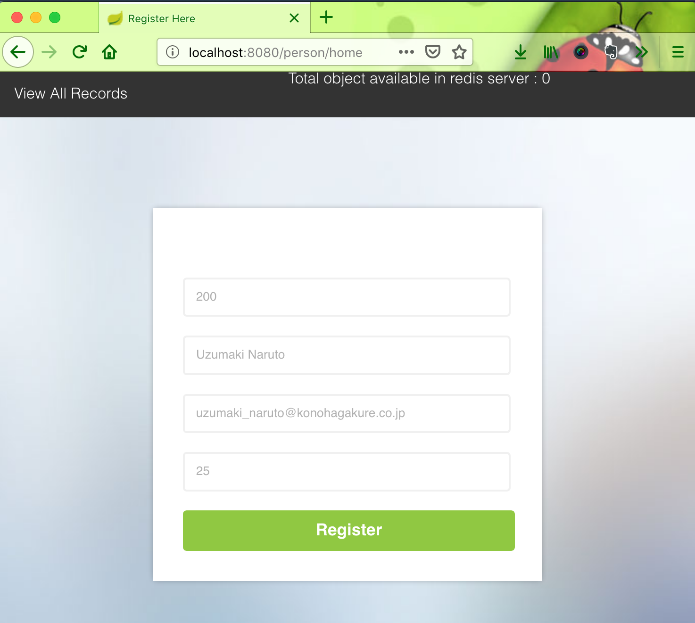
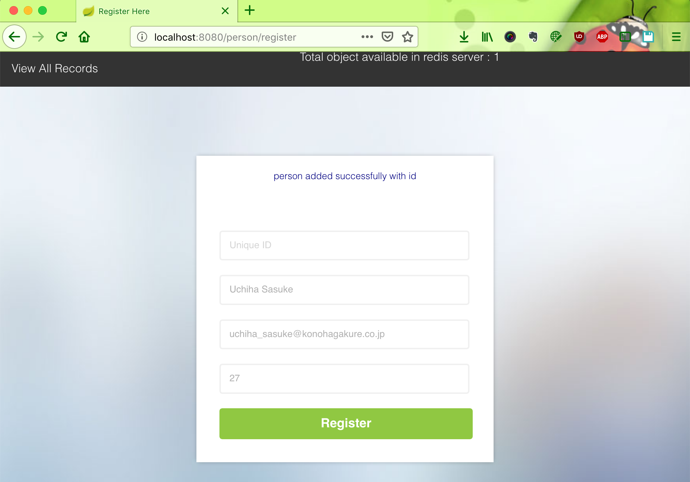
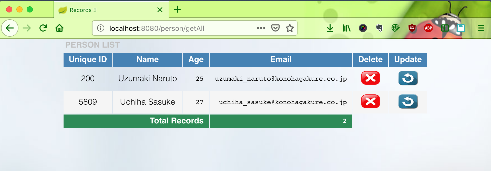
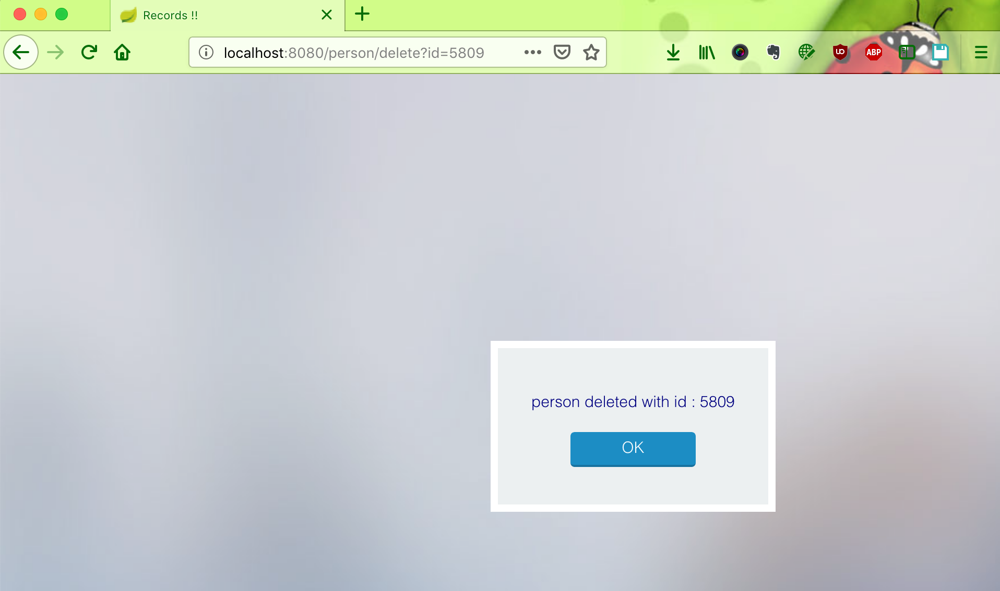

# Spring-Redis-Example

[](https://github.com/hendisantika/Spring-Redis-Example/actions/workflows/maven.yml)


A Spring Boot + Thymeleaf CRUD example that stores `Person` records in **Redis** via `RedisTemplate` (Jedis client),
showing how Redis can be used as a fast data store compared to a traditional database.

## Tech Stack

| Component      | Version                                  |
|----------------|------------------------------------------|
| Java           | 25 (Temurin / any JDK 25 distribution)   |
| Spring Boot    | 3.5.16                                   |
| Redis          | 8.2 (`redis:8.2.0-alpine3.22` via Docker) |
| Build tool     | Maven Wrapper (Maven 3.9.11)             |
| Templates      | Thymeleaf                                |
| Other          | Spring Data Redis, Jedis, Lombok, Bean Validation, Docker Compose support |

## Prerequisites

- JDK 25
- Docker (with Docker Compose) — Redis is started automatically from `compose.yml`

## Run

```bash
./mvnw clean spring-boot:run
```

Thanks to `spring-boot-docker-compose`, the Redis container defined in [`compose.yml`](compose.yml) is started
automatically on port `6379` when the application boots.

Open <http://localhost:8080/>.

Prefer to run Redis yourself? Start it manually and the app will connect to `localhost:6379`:

```bash
docker compose up -d
```

## Build & Test

```bash
./mvnw clean verify
```

## Endpoints

Routes are available at the root (`/`) and under `/persons`.

| Method | Path                | Description                    |
|--------|---------------------|--------------------------------|
| GET    | `/`                 | Home / register form           |
| POST   | `/register`         | Create or update a person      |
| GET    | `/get/{id}`         | View a person by id            |
| GET    | `/getAll`           | List all persons               |
| GET    | `/updatePage/{id}`  | Edit form for a person         |
| GET    | `/delete?id={id}`   | Delete a person                |

## CI/CD & Dependency Updates

- **GitHub Actions** ([`maven.yml`](.github/workflows/maven.yml)) builds and tests on JDK 25 for every push and pull
  request to `master`, and submits the Maven dependency graph on pushes to `master`.
- **Dependabot** ([`dependabot.yml`](.github/dependabot.yml)) checks Maven, GitHub Actions and Docker Compose weekly,
  grouping related updates (Spring Boot, Maven minor/patch, Actions) and using Conventional Commit prefixes.

## Screenshot

Home Page



Register Page



List All Page



Delete Page


